# Clean My GoogleTV (Universal Edition)

<div align="center">


<p align="center">
  <b>A universal, bloat-free performance optimization suite, tvOS-inspired spatial launcher, live memory task cleaner, and automated 1-click modular setup for ANY Google TV and Android TV device.</b>
</p>

</div>

---

## Before vs. After: The Transformation

Transform sluggish, ad-saturated Google TV interfaces into a lightning-fast, privacy-respecting, tvOS-inspired entertainment hub with zero ads and +500 MB to +1 GB of free RAM.

<div align="center">
  <table>
    <tr>
      <th align="center"><b>STOCK GOOGLE TV (BEFORE)</b><br/><i>Bloatware, sponsored carousels, auto-playing video teasers & ~376MB launcher RAM</i></th>
      <th align="center"><b>CLEAN MY GOOGLE TV (AFTER)</b><br/><i>Pristine 4K spatial design, custom wallpaper, live task cleaner & ~47MB launcher RAM</i></th>
    </tr>
    <tr>
      <td width="50%">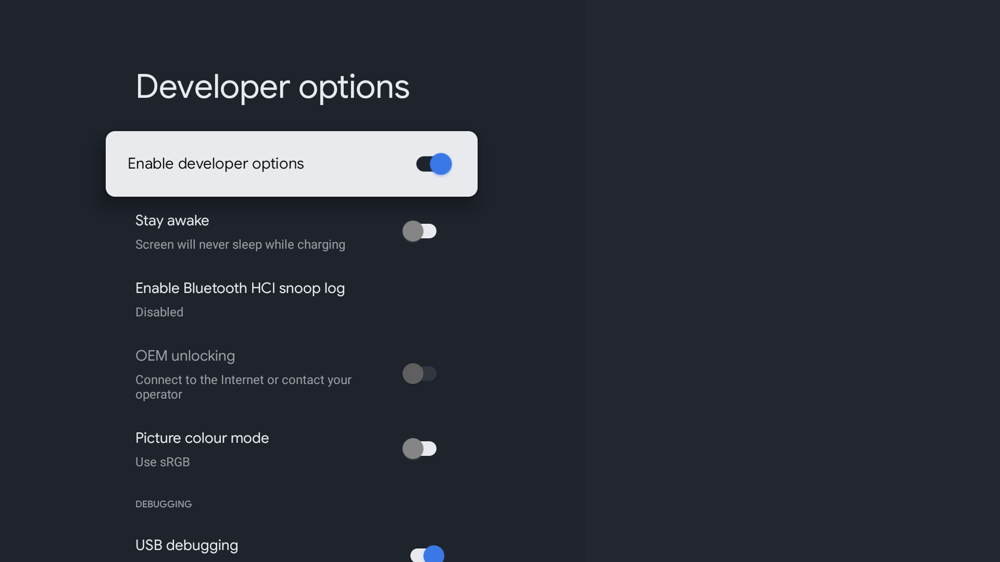</td>
      <td width="50%">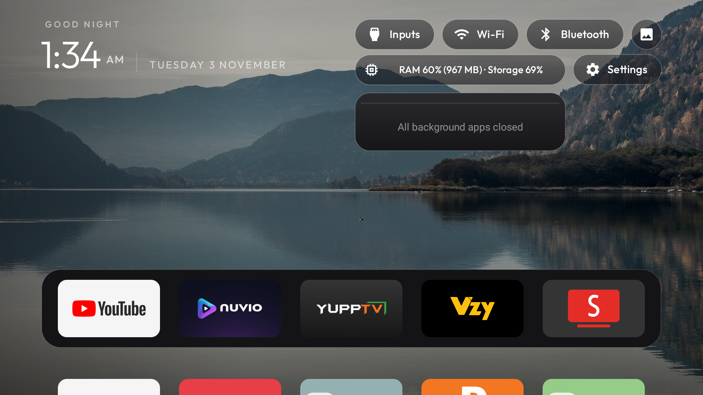</td>
    </tr>
  </table>
</div>

---

## Showcase & Visual Tour

### Clean Homescreen with Custom 4K Mountain Lake Wallpaper
> Zero sponsored ads, zero recommendation clutter, pure 4K spatial design with custom Mountain Lake wallpaper (`images/wallpaper_only.jpg`), fixed dock, and symmetrical top controls.

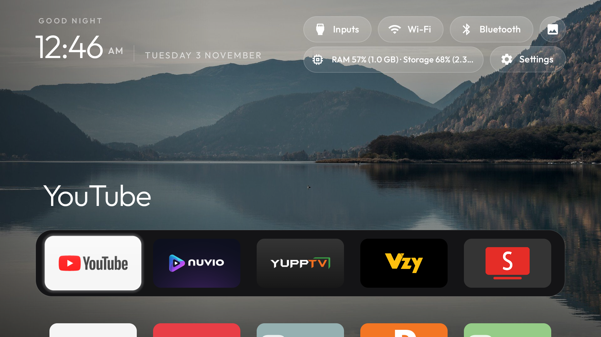

---

### Dual-Row Symmetrical Quick Actions Bar
> **Row 1:** `[Inputs]` · `[Wi-Fi]` · `[Bluetooth]` · `[Screensaver Circle]`  
> **Row 2:** `[RAM & Storage Live Stats Pill (Snug Fit)]` · `[Settings]`  
> Engineered with native Android auto-sizing text (`autoSizeTextType="uniform"`) so live capacity figures never truncate across any screen density or font scale.

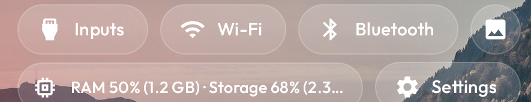

---

### Live Task Manager & RAM Cleaner
> Real-time background task monitoring with 1-click **"Close all"** and individual app kill buttons. Safely reclaims memory while preserving essential audio, input, and remote services.

<div align="center">
  <table>
    <tr>
      <th align="center"><b>Frosted Glass Task Popup</b></th>
      <th align="center"><b>Background Process Cleaner in Action</b></th>
    </tr>
    <tr>
      <td width="50%">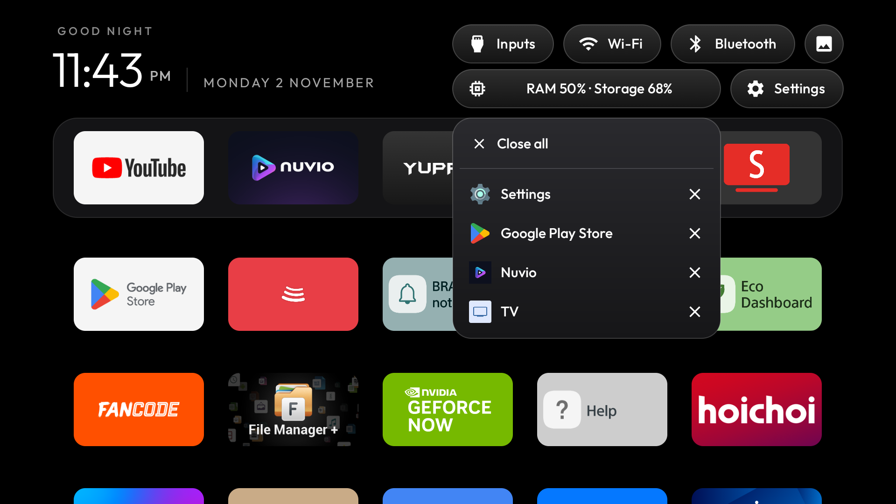</td>
      <td width="50%">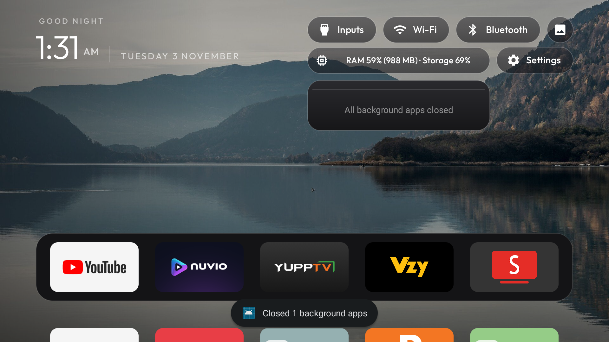</td>
    </tr>
  </table>
</div>

---

### Direct TV Inputs & Quick Settings Overlays
<div align="center">
  <table>
    <tr>
      <th align="center"><b>Direct HDMI & Live TV Switcher</b></th>
      <th align="center"><b>System Quick Settings Panel</b></th>
      <th align="center"><b>1-Press Bluetooth Quick Menu</b></th>
    </tr>
    <tr>
      <td>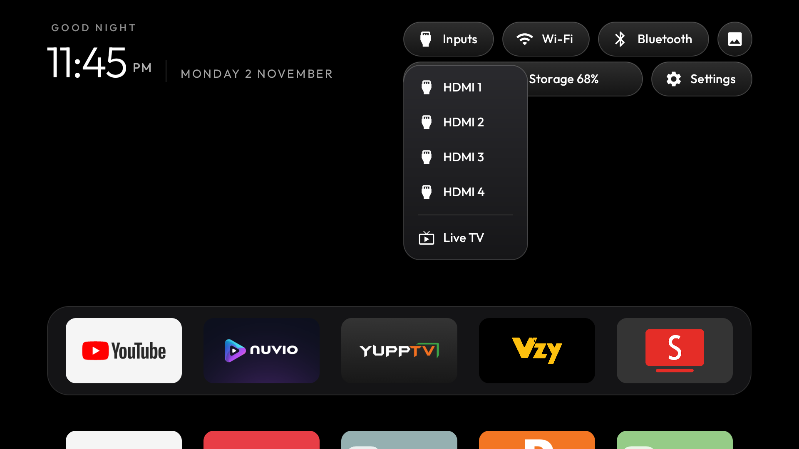</td>
      <td>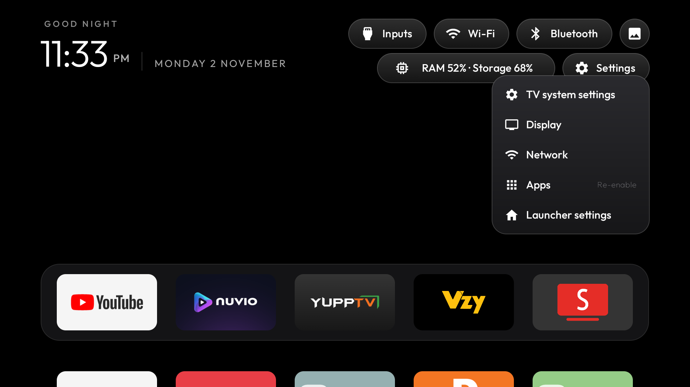</td>
      <td>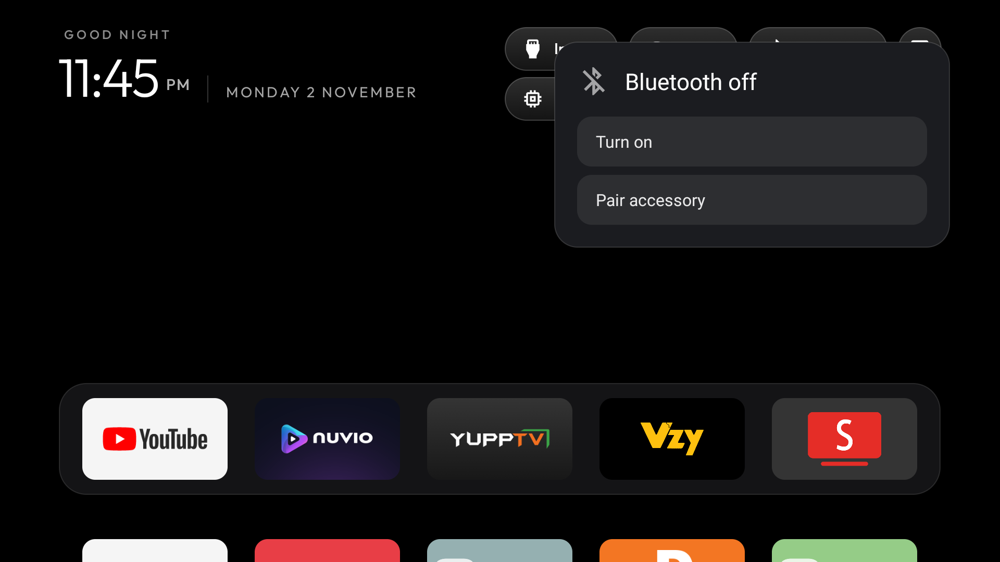</td>
    </tr>
  </table>
</div>

---

### Advanced System Settings & Apps Library
<div align="center">
  <table>
    <tr>
      <th align="center"><b>Full Quick Settings & Dashboard</b></th>
      <th align="center"><b>Clean Application Grid / Library</b></th>
      <th align="center"><b>Remotes & Accessories Settings</b></th>
    </tr>
    <tr>
      <td>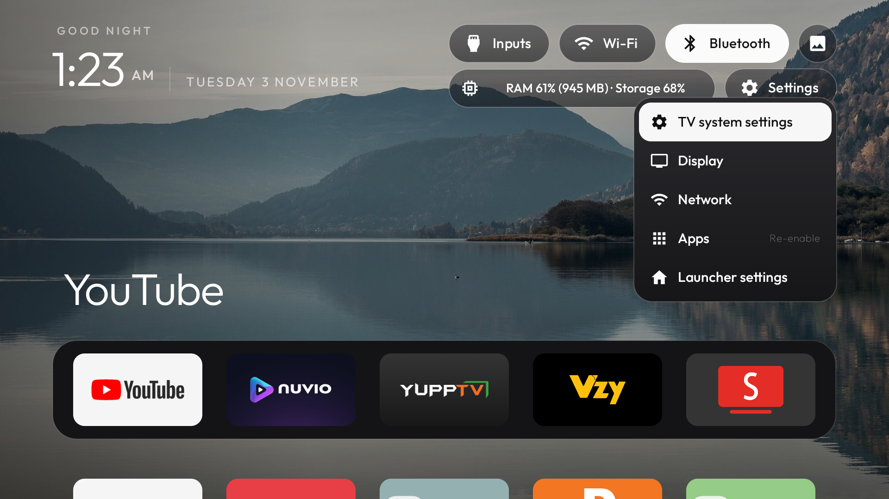</td>
      <td>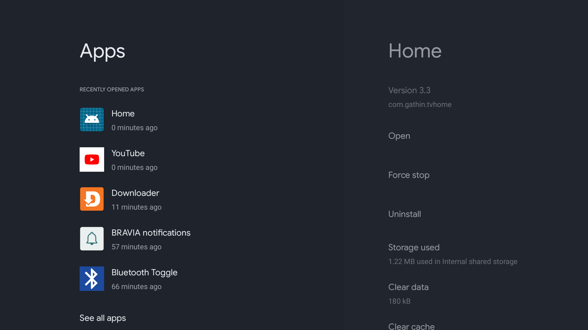</td>
      <td>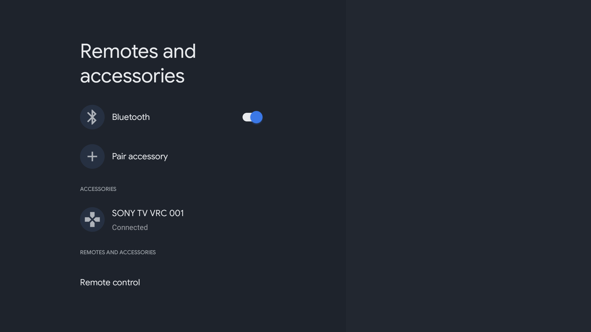</td>
    </tr>
  </table>
</div>

---

## Key Features & Enhancements

1. **Complete Google TV Bloatware Stripped**:
   - Disables telemetry and tracking daemons including `tv.samba.ssm` (Automated Content Recognition) and `com.google.android.partnersetup` (RLZ attribution pings).
   - Eliminates launcher lag, sponsored video feeds, auto-playing trailers, and unwanted Google recommendation carousels.

2. **Snug-Fit Real-Time Stats Pill**:
   - Replaces fixed, truncated labels with dynamically auto-sized text (`autoSizeTextType="uniform"` between `10sp` and `13.5sp`).
   - Displays live `RAM % (Available RAM) · Storage %` with clean, snug alignment across all font scaling options.

3. **Active Task Manager & Memory Reclaimer**:
   - Tracks live active tasks via Android `UsageStatsManager`.
   - 1-click **"Close all"** safely frees background memory and immediately refreshes system stats.
   - Built-in safe-kill whitelist protects system UI, Bluetooth audio, TV input methods, and remote controllers.

4. **Crisp Multi-Density App Icon Suite**:
   - Fully resolves missing icon fallbacks by providing crisp 32-bit raster PNG mipmaps across all standard Android densities (`mdpi`, `hdpi`, `xhdpi`, `xxhdpi`, `xxxhdpi`) plus a standard 320x180 Leanback banner.
   - Guaranteed pixel-perfect rendering across Android TV Leanback, Toast notifications, App Details, and Recent Apps menus.

5. **Wallpaper Purity & Neutral Accents**:
   - Disables dynamic app-specific color tinting (`ambient_glow: false`, `cinematic_white_focus: true`). Focus highlights remain clean frosted glass without bathing the screen in distracting color shifts.
   - Enhanced 32-bit ARGB_8888 wallpaper decoding with `wallpaper_dim: 35` for optimal readability and contrast.

6. **100% Remote Key Interception (`HomeKeyService`)**:
   - Default Home mapped permanently to CleanYourTV Enhanced. Pressing the Home button on any remote will **never** return you to the stock Google TV launcher.
   - Dedicated Settings remote key mapped to open the Quick Settings overlay panel directly.

7. **Native Bluetooth Quick Menu**:
   - Clicking the Bluetooth pill opens a custom smoked frosted-glass menu with 3 options: Live Turn On/Off toggle, Pair accessory, and a Direct shortcut to Bluetooth Accessories Settings.

8. **Firmware Update Prevention (Anti-OTA)**:
   - System updates disabled in user space via `com.mediatek.tv.systemupdater` and vendor update centers.
   - Automatic background download flag disabled (`settings put global ota_disable_automatic_update 1`).
   - Network DNS domain blocking guide provided in [`guide/Tier3_Network_Block_Guide.md`](guide/Tier3_Network_Block_Guide.md).

9. **Physical Ports & Hardware Parity Preserved**:
   - Full hardware integrity maintained: USB mass storage, external HDD/SSD mounting (`vold`), HDMI 1–4, eARC, HDMI-CEC, analog AV in, DVB tuner, Ethernet, Wi-Fi, and Bluetooth accessories remain 100% functional.

---

## Universal Device Compatibility Matrix

This suite is engineered to run seamlessly across all major Google TV and Android TV devices:

| Manufacturer / Brand | Notable Tested Models | Architecture | Supported Android Versions |
| :--- | :--- | :--- | :--- |
| **Sony BRAVIA** | BRAVIA 2 (`K-43S22BM2`), X80, X85, X90, XR-series, A80, A90 | `armeabi-v7a` | Android 9, 10, 11, 12, 14 |
| **Google** | Chromecast with Google TV (4K), Chromecast (HD), Google TV Streamer | `armeabi-v7a` / `arm64-v8a` | Android 10, 11, 12, 14 |
| **Walmart onn.** | onn. Google TV 4K Streaming Box, onn. 4K Pro Streaming Box | `armeabi-v7a` | Android 11, 12, 14 |
| **TCL** | TCL C-Series, P-Series, Q-Series Google TVs | `armeabi-v7a` | Android 11, 12 |
| **Hisense** | Hisense U6, U7, U8, A6 Series Google TVs | `armeabi-v7a` | Android 11, 12 |
| **Nvidia** | Nvidia Shield TV, Nvidia Shield TV Pro | `arm64-v8a` | Android 9, 11 (Shield Experience 9+) |
| **Xiaomi** | Mi TV Stick 4K, Mi Box S (2nd Gen), Xiaomi TV series | `armeabi-v7a` | Android 9, 10, 11 |
| **Philips** | Philips Ambilight Android TV & Google TV series | `armeabi-v7a` | Android 10, 11, 12 |

---

## Warranty & Safety Analysis

> [!NOTE]
> ### Will these optimizations void my TV warranty?
> **Short Answer: NO, absolutely not.**

### Detailed Technical Reasons:
1. **Zero Root Access Required (`No Su / No Bootloader Unlock`)**:
   - Everything is achieved using official, standard Android developer APIs (`pm disable-user`, `cmd package set-home-activity`, and `appops`).
   - The bootloader remains locked, system partitions (`/system`, `/vendor`) remain untouched read-only images, and dm-verity status is unmodified.
2. **100% Reversible with a Standard Factory Reset or Script**:
   - All package disabling happens at the user profile level (`--user 0`).
   - Running `backup/restore_all.bat` re-enables all apps instantly over ADB.
   - Performing a standard TV Factory Reset (via Settings or by holding the TV's physical power button on boot) wipes user profile data and instantly restores all factory apps to their out-of-the-box state.
3. **Consumer Warranty Protection**:
   - Manufacturer warranties cover hardware, panel, power supply, and factory software integrity. Disabling user-space bloatware through standard developer tools does not void your hardware warranty.

---

## 1-Click Quick Start Guide

### Step 1: Enable USB Debugging on Your TV
1. On your Google TV / Android TV, go to **Settings → System → About**.
2. Click **Android TV OS Build** 7 times until you see `"You are now a developer!"`.
3. Go back to **Settings → System → Developer Options**:
   - Turn **USB Debugging** = **ON**.
   *(On Android TV, enabling USB Debugging automatically starts ADB listening on TCP port 5555 over Wi-Fi / Ethernet).*
4. Note your TV's IP address in **Settings → Network & Internet** (e.g. `192.168.1.50`).

---

### Step 2: 1-Click Universal Installation

1. Clone or download this repository on your computer:
   ```bash
   git clone https://github.com/your-username/clean-my-googletv.git
   cd clean-my-googletv
   ```
2. Run the universal installer:
   ```cmd
   apk\install_all_apks.bat
   ```
   *The script will automatically detect any connected ADB device or prompt you for your TV's IP address.*

3. Look at your TV screen and select **"Always allow from this computer"** → **Allow**.

4. The script will automatically:
   - Identify your TV model and CPU architecture.
   - Download the latest ARM releases of **SmartTube**, **Stremio**, **Nuvio TV**, and **BitChord TV** from official web sources.
   - Install **CleanYourTV Enhanced** and all modular add-ons (`apk/`).
   - Grant required permissions (`WRITE_SECURE_SETTINGS`, `BLUETOOTH_CONNECT`, `GET_USAGE_STATS`).
   - Enable `HomeKeyService` accessibility service and set CleanYourTV as default Home.
   - Push and configure the Nature Calm wallpaper at dim 35.

---

### Step 3: Optional Universal Debloating

To eliminate telemetry and reclaim RAM, run the universal debloat commands (or inspect [`guide/Universal_Google_TV_Debloat_Guide.md`](guide/Universal_Google_TV_Debloat_Guide.md)):

```bash
# Disable Google telemetry and tracking
adb shell pm disable-user --user 0 tv.samba.ssm
adb shell pm disable-user --user 0 com.google.android.feedback
adb shell pm disable-user --user 0 com.google.android.partnersetup
adb shell pm disable-user --user 0 com.google.android.tvrecommendations

# Disable stock Google TV launcher & setup wizard
adb shell pm disable-user --user 0 com.google.android.apps.tv.launcherx
adb shell pm disable-user --user 0 com.google.android.tungsten.setupwraith

# Prevent automatic OTA background updates
adb shell settings put global ota_disable_automatic_update 1
```

---

## Components & Module Directory

| Component | Package / Binary | Role / Description |
| :--- | :--- | :--- |
| **CleanYourTV Enhanced** | `com.gathin.tvhome` | Custom tvOS spatial launcher with symmetrical 4+2 quick bar, live task cleaner, multi-density crisp icons, and auto-sizing metrics. |
| **Bluetooth Toggle** | `io.github.justinnewman.bluetoothtoggle` | 1-press Bluetooth toggle dropdown and pairing shortcut. |
| **Bluetooth Connect** | `io.github.justinnewman.bluetoothconnect` | Direct accessory connection provider. |
| **Headphones Routing** | `io.github.justinnewman.headphones` | Fast audio output switcher between TV speakers and Bluetooth headphones. |
| **Capacity Stats** | `io.github.justinnewman.capacitystats` | Real-time RAM and internal storage capacity provider for the launcher pill. |
| **AirPlay Status** | `io.github.justinnewman.airplaystatus` | Screen mirroring and AirPlay status receiver. |
| **Webmote** | `com.maxhayim.webmote` | Lightweight web browser remote control accessible from any phone on Wi-Fi. |
| **SmartTube** | `org.smarttube.stable` | Advanced open-source YouTube client with ad-blocking and SponsorBlock. |
| **Stremio Android TV** | `com.stremio.one` | Official media and streaming hub for Android TV. |
| **Nuvio TV** | `com.nuvio.tv` | Elegant streaming and media browser for Android TV. |
| **BitChord TV** | `com.music.bitchord.tv` | Apple Music-style Hi-Res YouTube Music & local audio player with TV interface. |

---

## 100% Reversibility & Emergency Restore

If you ever wish to return your TV to 100% stock factory settings:

### Option A: Automated ADB Restore (Preserves personal apps & logins)
Run the universal restore script from your PC:
```cmd
backup\restore_all.bat
```
*(or run `backup\restore_all.ps1` in PowerShell)*

### Option B: Hardware Factory Reset (Zero PC required)
1. On your TV remote, press the **Settings** button.
2. Go to **System** → **About** → **Reset**.
3. Select **Factory data reset** → **Erase everything**.
4. The TV reboots in pristine out-of-the-box condition with all factory Google apps running.

---

## Documentation Index

- [Master Automation Prompt for AI & Developers](MASTER_PROMPT.md)
- [Universal Google TV Debloat Guide](guide/Universal_Google_TV_Debloat_Guide.md)
- [Universal Connection & ADB Debugging Guide](guide/Connection_and_Debugging_Guide.md)
- [Pre-Debloat Audit & Device Specifications](guide/TV_Before_Debloat.md)
- [Final Debloat & Customization Report](guide/Final_Debloat_and_Customization_Report.md)
- [Firmware Updates Prevention Plan (Tier 1 & Tier 2)](guide/Stop_TV_Firmware_Updates_Plan.md)
- [Tier 3 Network & Router Domain Blocking Guide](guide/Tier3_Network_Block_Guide.md)
- [Release Notes & Package Specifications](RELEASE_NOTES.md)

---

## Credits & Upstream Repositories

Special thanks and full credit to the original creators and open-source communities:

* **[CleanYourTV](https://github.com/Gathin23/cleanyourtv)** by [@Gathin23](https://github.com/Gathin23)
* **[CleanYourTV Add-ons](https://github.com/justin-newman)** by [@justin-newman](https://github.com/justin-newman)
* **[Webmote](https://github.com/maxhayim/webmote)** by [@maxhayim](https://github.com/maxhayim)
* **[SmartTube](https://github.com/yuliskov/SmartTube)** by [@yuliskov](https://github.com/yuliskov)
* **[Stremio](https://github.com/Stremio)** by the [Stremio Team](https://www.stremio.com)
* **[Nuvio TV](https://github.com/NuvioMedia/NuvioTV)** by [NuvioMedia](https://nuvio.tv)
* **[BitChord](https://github.com/kushagrasinghx/BitChord)** by [@kushagrasinghx](https://github.com/kushagrasinghx)

---

## License

This repository and custom enhancements are open-source and released under the **MIT License**. Third-party APKs and sub-modules belong to their respective copyright holders and open-source licenses.
