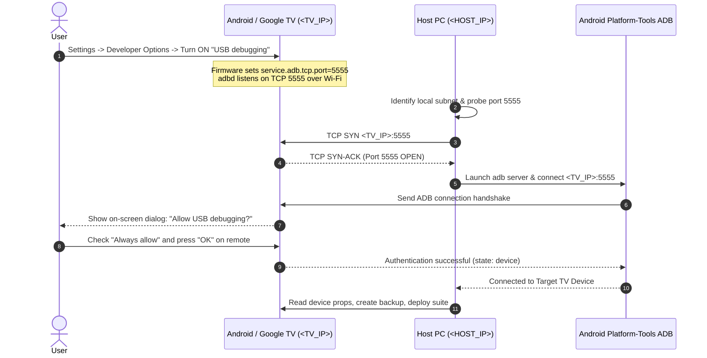

# Universal Connection & ADB Debugging Technical Guide for Android & Google TV

**Platform Coverage**: Universal Google TV & Android TV (Android 9, 10, 11, 12, 14)  
**Hardware Reference Tested**: Sony BRAVIA 4K (BRAVIA 2 Series, `K-43S22BM2`), Chromecast with Google TV, TCL, Hisense  
**Default Protocol Port**: TCP `5555` (ADB over Wi-Fi / Ethernet)  

---

## 1. Why "Wireless Debugging" Differs Between TV Models

On Android mobile phones (Android 11+), Google introduced a distinct menu item named **Wireless Debugging** that uses TLS encryption, dynamic pairing codes, and randomized ports (via mDNS).

However, on **Google TV and Android TV devices** (especially Sony BRAVIA, TCL, Hisense, and MediaTek-based chipsets):
* Manufacturers typically do **not** expose the mobile-style "Wireless Debugging" pairing code menu in the TV Settings UI.
* Instead, TV firmware links network ADB directly to the standard **"USB Debugging"** toggle.
* When you toggle **USB Debugging = ON** on your TV, the system firmware automatically executes:
  ```properties
  service.adb.tcp.port = 5555
  ro.adb.secure = 1
  ```
* This commands the underlying Android debug daemon (`adbd`) to listen for incoming connections over your local network (Wi-Fi or Ethernet) on standard Android TCP port **`5555`**.

> [!NOTE]
> Even though the toggle is labeled "USB debugging", on Android TV it simultaneously exposes ADB over TCP port 5555 across your local Wi-Fi network.

---

## 2. Issues Commonly Encountered & How to Solve Them

During the discovery and connection phase on any Android TV, five specific challenges may occur:

### Issue 1: Outdated ADB Binary on the Host PC (`v1.0.32` vs `v1.0.41`)
* **Symptom**: Running `adb devices` or `adb connect` fails or triggers continuous daemon crashes (`adb server version does not match this client`).
* **Root Cause**: Many Windows PCs have legacy ADB executables in old paths (e.g., `C:\adb\adb.exe` dating back to Android 4.x/5.x). Old versions cannot complete RSA key exchange with modern Android 11/12/14 devices.
* **Solution**: Standardize on modern Android SDK Platform-Tools ADB (`v1.0.41`, build 34+). Path is typically:
  ```powershell
  $env:LOCALAPPDATA\Android\Sdk\platform-tools\adb.exe
  ```
  Or install it via winget / chocolatey:
  ```powershell
  winget install Google.PlatformTools
  ```

### Issue 2: Unknown Device IP on the Subnet
* **Symptom**: The TV's exact local IP address is not immediately known, and `adb devices` returns an empty list.
* **Solution**: You can either find the IP in TV Settings (**Settings → Network & Internet → Connected Wi-Fi/Ethernet → IP address**), or run this fast PowerShell subnet scan on port 5555:
  ```powershell
  # Fast parallel port 5555 scanner across local subnet
  $localSubnet = ((Get-NetIPAddress -AddressFamily IPv4 | Where-Object { $_.IPAddress -like "192.168.*" }).IPAddress -split '\.')[0..2] -join '.'
  1..254 | ForEach-Object -Parallel {
      $ip = "$using:localSubnet.$_"
      $socket = New-Object System.Net.Sockets.TcpClient
      $async = $socket.BeginConnect($ip, 5555, $null, $null)
      if ($async.AsyncWaitHandle.WaitOne(120, $false)) {
          try {
              $socket.EndConnect($async)
              [PSCustomObject]@{ IP = $ip; Port = 5555; Status = "OPEN (TV Found!)" }
          } catch {}
      }
      $socket.Close()
  } -ThrottleLimit 50
  ```

### Issue 3: Initial Authentication Handshake (`failed to authenticate`)
* **Symptom**: Running `adb connect <TV_IP>:5555` prints `failed to authenticate to <TV_IP>:5555` or shows `unauthorized`.
* **Root Cause**: `ro.adb.secure=1` is enabled on production Android builds. When an unrecognized PC attempts connection, Android rejects shell access until the PC's RSA public key is authorized by a physical user.
* **Solution**: The moment the connection command runs, look at your TV screen. A prompt will appear: **"Allow USB debugging?"**.
  - Check the box: **"Always allow from this computer"**.
  - Select **"Allow"** with your TV remote.
  - The status will immediately transition from `unauthorized` to `device`:
    ```text
    <TV_IP>:5555  device product:<DEVICE_CODENAME> model:<DEVICE_MODEL>
    ```

### Issue 4: Python Script Dependencies (`tv.py`)
* **Symptom**: Upstream diagnostic script `cleanyourtv_repo/tools/tv.py` fails with `ModuleNotFoundError: No module named 'adb_shell'`.
* **Solution**: Build an isolated virtual environment in `cleanyourtv_repo/tools/venv/` and install required packages:
  ```bash
  python -m venv cleanyourtv_repo/tools/venv
  cleanyourtv_repo/tools/venv/Scripts/pip install adb-shell rsa cryptography
  ```

### Issue 5: Wi-Fi Disconnection Safety Verification
* **Symptom / Risk**: On some Google TV builds, disabling the setup wizard (`setupwraith`) or stock launcher might theoretically drop saved Wi-Fi credentials if they are tied to a user app.
* **Verification**: Before disabling any launcher or setup package, verify who owns the Wi-Fi connection:
  ```bash
  adb shell dumpsys wifi | grep -o 'cname=[^ ]*'
  ```
  Result returns `cname=android.uid.system:1000`. This confirms that Wi-Fi networking is owned by the Android OS kernel/system itself, **not** by the setup wizard, ensuring zero risk of losing network connection during debloating.

---

## 3. Step-by-Step Connection Flow Diagram



---

## 4. Security Recommendations & Post-Debloat Cleanup

Because opening port `5555` allows ADB network commands on your local subnet:
* While actively modifying the TV, keep your Wi-Fi network secure and private.
* Once debloating, launcher configuration, and verification are finished, you can optionally turn **USB debugging = OFF** in TV Developer Settings.
* Turning it OFF terminates port 5555. CleanYourTV Enhanced, all add-ons, wallpapers, and Task Manager continue running smoothly without requiring an active ADB connection.
