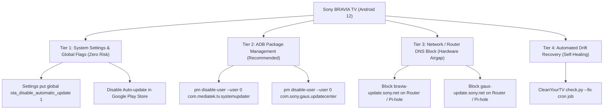

# Stop Sony BRAVIA / Google TV Firmware Updates: Architectural Plan

> [!IMPORTANT]
> **Status:** 
> - **Tier 1 (Global Settings):** [ACTIVE] Implemented & Verified (`ota_disable_automatic_update = 1`)
> - **Tier 2 (ADB Package Management):** [ACTIVE] Implemented & Verified (`com.mediatek.tv.systemupdater` & `com.sony.gaus.updatecenter` disabled)
> - **Tier 3 (Network / Router DNS Block):** [REFERENCE] Guide Ready (See [Tier3_Network_Block_Guide.md](file:///guide/Tier3_Network_Block_Guide.md) to apply whenever you choose)

---

## 1. Why Firmware Updates Pose a Risk
When a smart TV receives an Over-The-Air (OTA) firmware upgrade:
1. **Re-enables Bloatware:** Android system updates flash the `/system` and `/vendor` partitions, resetting disabled user packages.
2. **Reverts Stock Launcher:** Google TV updates frequently overwrite the default `HOME` activity intent handler and disable accessibility services (`HomeKeyService`), forcing the TV back to the stock ad-heavy Google TV UI.
3. **Restricts ADB Permissions:** Newer Android TV versions (Android 13/14) impose tighter sandboxing (e.g., blocking Bluetooth toggling by third-party apps, restricting background accessibility services).

---

## 2. Multi-Tier Defense Strategy



---

### Tier 1: In-OS System Toggles (Zero Risk)
These settings instruct the Android OS and Google services to stop initiating automatic background downloads and installs.

1. **Global Android OTA Setting via ADB:**
   ```bash
   adb shell settings put global ota_disable_automatic_update 1
   ```
2. **Sony BRAVIA Native Setting:**
   - Navigate to: **Settings** -> **System** -> **About** -> **System software update**.
   - Toggle **Automatically check for update** to **OFF**.
3. **Google Play Store Auto-Updates:**
   - Open **Google Play Store** -> Profile icon -> **Settings** -> **Auto-update apps** -> Select **Don't auto-update apps**.

---

### Tier 2: ADB Package Disabling (Recommended & Fully Reversible)
On Sony BRAVIA (MediaTek MT5896 / Android 12), OTA downloads and background update notifications are governed by two specific system packages:

| Package Identifier | Description | Role in System |
| :--- | :--- | :--- |
| `com.mediatek.tv.systemupdater` | MediaTek System Updater | Handles local firmware flashing & OTA recovery hooks |
| `com.sony.gaus.updatecenter` | Sony GAUS Update Center | Queries Sony cloud servers for BRAVIA firmware updates |

#### Action Commands (When Approved):
```bash
adb shell pm disable-user --user 0 com.mediatek.tv.systemupdater
adb shell pm disable-user --user 0 com.sony.gaus.updatecenter
```

#### Verification:
```bash
adb shell pm list packages -d | grep -E "updater|updatecenter"
```
*(Expected output: both packages listed under disabled)*

#### 1-Click Rollback / Re-Enable:
If you ever want to check for an official Sony update in the future:
```bash
adb shell pm enable com.mediatek.tv.systemupdater
adb shell pm enable com.sony.gaus.updatecenter
```

---

### Tier 3: Network / Router DNS Block (Hardware Airgap)
If you run a smart router (e.g., Asus Merlin, OpenWrt, pfSense) or a DNS sinkhole (Pi-hole, AdGuard Home, NextDNS), you can block Sony update endpoints before they reach the TV.

#### Recommended Blocklist Domains:
- `bravia-update.sony.net`
- `gaus-update.sony.net`
- `ssm1.internet.sony.tv`
- `bravia.dl.playstation.net`
- `ota.googlezip.net`

> [!TIP]
> **Manual Offline Updates via USB:** Even with all OTA domains blocked, Sony TVs allow manual firmware upgrades via USB flash drive. You can always download firmware `.zip` files from Sony's official support website if a critical feature is released.

---

### Tier 4: Automated Self-Healing (`check.py --fix`)
CleanYourTV includes a built-in diagnostic and self-healing engine in `tools/check.py`:
- In the event that a forced update ever slips through, running:
  ```bash
  tools\venv\Scripts\python.exe -I tools\check.py examples\sony-bravia\debloat.txt --fix
  ```
  will re-disable any restored bloatware and return Home to CleanYourTV in under 10 seconds.

---

## 3. Comparison of Approaches

| Approach | Reliability | Ease of Reversal | Impact on Streaming Apps |
| :--- | :---: | :---: | :---: |
| **Tier 1 (Settings Toggle)** | Medium (OS may still notify) | Instant (Toggle UI) | None |
| **Tier 2 (ADB Disabling)** | **High (Guaranteed no OTA)** | **Instant (1 command)** | **None (Netflix, YT, Stremio unaffected)** |
| **Tier 3 (DNS Block)** | High (Network wide) | Easy (Router UI) | None |
| **Tier 4 (Self-Healing)** | Backup Safety Net | N/A | Restores system in seconds |

> [!NOTE]
> Please review this plan. Whenever you are ready, let me know which tier (or combination) you would like to proceed with.
